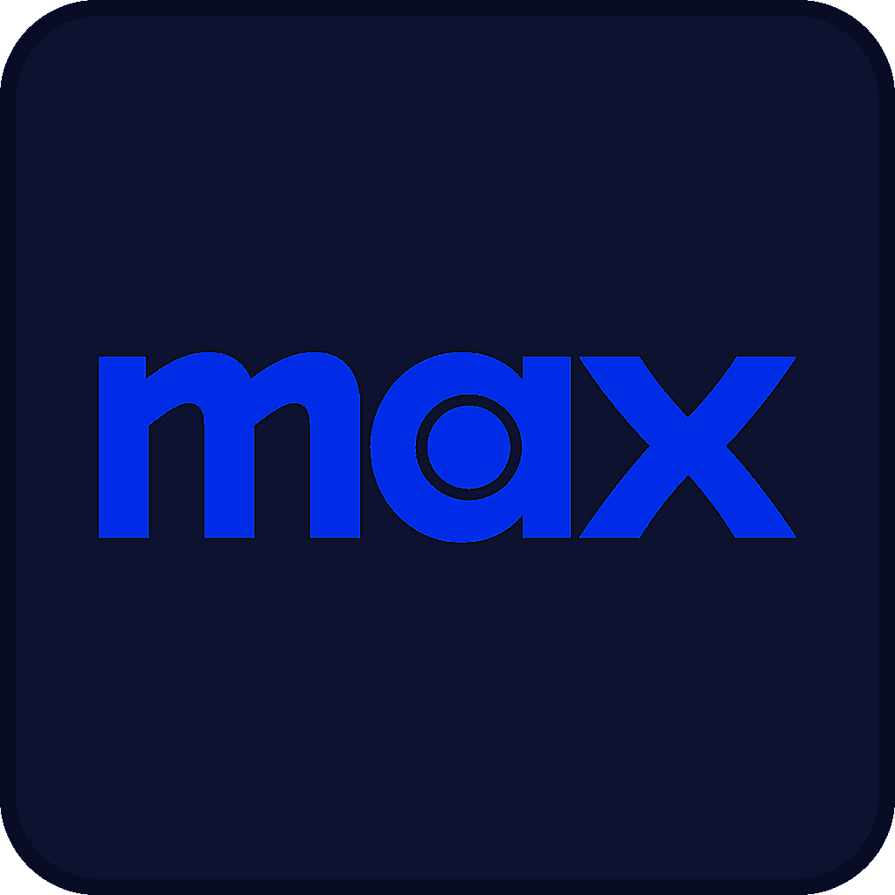
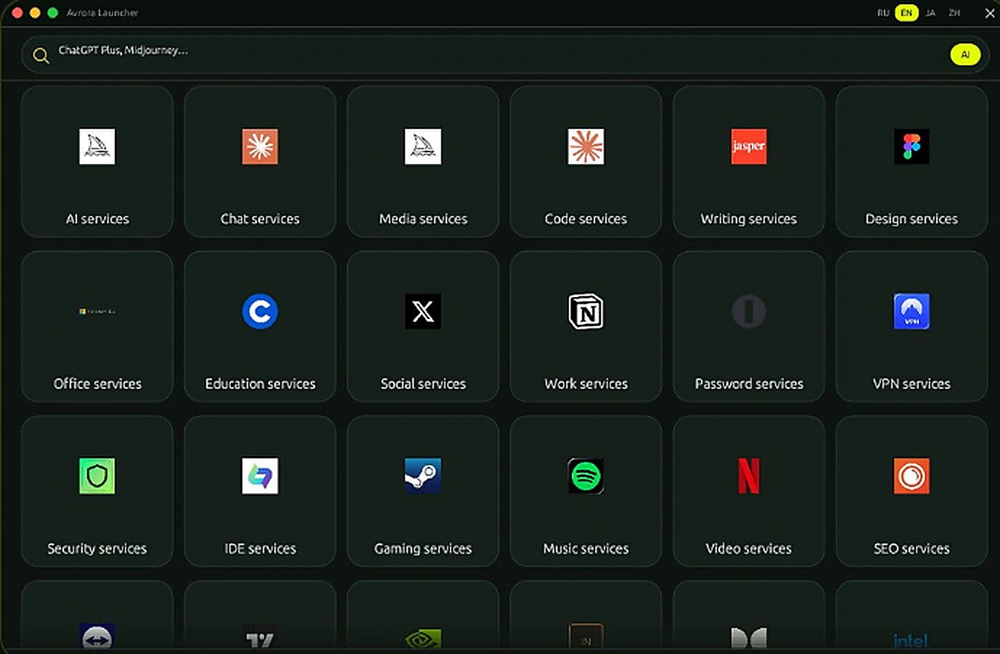

# Max Ad-Free Free 2026 — HBO, Warner, DC, 4K Dolby Vision

> **Max is paid everywhere. In our Aivora launcher the same paid Ad-Free version is free.**
>
> Official site / app store = paid Ad-Free subscription. Aivora launcher = that paid Ad-Free product, free on Windows 10 / 11.

**Keywords:** Max HBO · Max Ad-Free · Max windows · HBO Max · Dolby Vision · paid Max free through launcher · Aivora Programs

Windows 10 / 11 · Max Ad-Free · Video streaming

The orange button opens [https://aivoraprograms.com/](https://aivoraprograms.com/). Install Aivora, then **Activate** **Max**. You get the **paid Ad-Free** product **for free in our launcher**. No `Max.exe` in this repository.

## What Max is

Max Ad-Free is the paid Warner catalog: **HBO Originals**, **Warner day-and-date**, DC and Cartoon Network, **4K Dolby Vision**, kids profiles, offline. The Aivora card is **Ad-Free**, not an official free SKU. This is not Netflix Premium and not Disney+.

**Max is paid everywhere else.** Official access is a Ad-Free subscription. In **our Aivora launcher** that same paid Ad-Free is **free** on Windows 10 / 11. No vendor account. No credit card.

## HBO, Warner, DC, 4K Dolby Vision

Day-and-date is the cinema extra. Dolby Vision is title-dependent. After **Activate**, open Max from video streaming. This repo has no movie file.

## Who this Windows page is for

Searches **Max**, **HBO Max**, **Max windows**, **Max free** wanting **paid Ad-Free**.

## What the Ad-Free card includes

| Feature | Official Max | In our Aivora launcher |
|---------|--------------|------------------------|
| Price | Paid Ad-Free subscription | **Free** (same paid Ad-Free) |
| **HBO Originals** | Ad-Free | Same paid Ad-Free, free here |
| **Warner day-and-date** | Ad-Free | Same paid Ad-Free, free here |
| **4K Dolby Vision** | Ad-Free | Same paid Ad-Free, free here |

## How to open paid Max on Windows

1. Open [https://aivoraprograms.com/](https://aivoraprograms.com/)
2. Download **Aivora Launcher**
3. Install on **Windows 10** or **Windows 11** (64-bit)
4. Open **Video streaming**
5. Find **Max** and press **Activate**

Paid Max Ad-Free — **free in our launcher**, paid on the official site.

## Search queries this page covers

- **Max HBO**
- **HBO Max free**
- **Max windows**
- **Dolby Vision**
- **paid Max free through launcher**

## Screenshots

Aivora launcher hub — **Video streaming** → **Max**:

## FAQ

**Is this Netflix?**  
No. Netflix Premium is a different Aivora card. This tile is Max Ad-Free.

**Where is the download?**  
[https://aivoraprograms.com/](https://aivoraprograms.com/)

**Is Max paid or free?**  
Paid everywhere (official Ad-Free). **Free in our Aivora launcher** — same paid Ad-Free version.

**Do I need a Max account?**  
No. **Activate** on the tile.

---

## На русском

# Max Ad-Free бесплатно 2026 — HBO, Warner, DC, 4K Dolby Vision

> **Везде Max платный. В нашем лаунчере Aivora та же платная версия Ad-Free — бесплатно.**
>
> Официальный сайт / магазин = платная подписка Ad-Free. Лаунчер Aivora = этот же платный Ad-Free, бесплатно на Windows 10 / 11.

**Ключевые слова:** Max HBO · Max без рекламы · Max windows · HBO Max · Dolby Vision · платный Max бесплатно через лаунчер · Aivora Programs

Оранжевая кнопка — главная Aivora. Лаунчер → **Стриминг видео** → **Max** → **Активировать**. Это **платный Ad-Free**, у нас в лаунчере **бесплатно**.

Max Ad-Free — платный каталог Warner: **HBO Originals**, **премьеры Warner в день кинотеатра**, DC, Cartoon Network, **4K Dolby Vision**. Карточка Aivora — **Ad-Free**, не официальный free. Это не Netflix и не Disney+.

**Max везде платный.** Официально подписка Ad-Free. **В нашем лаунчере Aivora** та же платная Ad-Free-версия — **бесплатно** на Windows 10 / 11.

Day-and-date — в день кинотеатра. Dolby Vision — где есть тайтл. Фильмов в git нет.

Запросы **Max**, **HBO Max бесплатно** — нужен **платный Ad-Free**.

| Функция | Официально | В нашем лаунчере Aivora |
|---------|------------|-------------------------|
| Цена | Платная подписка Ad-Free | **Бесплатно** (тот же Ad-Free) |
| **HBO Originals** | Ad-Free | Та же платная Ad-Free, у нас бесплатно |
| **Warner в день кинотеатра** | Ad-Free | Та же платная Ad-Free, у нас бесплатно |
| **4K Dolby Vision** | Ad-Free | Та же платная Ad-Free, у нас бесплатно |

Как открыть: [https://aivoraprograms.com/](https://aivoraprograms.com/) → лаунчер → **Стриминг видео** → **Max** → **Активировать**.

**Это Netflix?**  
Нет. Netflix — другая карточка. Здесь Max Ad-Free.

Max — товарный знак Warner Bros. Discovery, Inc.. Страница описывает доступ через Aivora Programs.

[https://aivoraprograms.com](https://aivoraprograms.com/) · hello@aivora.app

#windows11 #windows10 #hbomax #streaming #aivora

---

*Max HBO · Max Ad-Free · Max windows · HBO Max · Dolby Vision · paid Max free through launcher · Aivora Programs · paid Max free through launcher · Aivora Programs · https://aivoraprograms.com/programs/max-hbo-max/*
